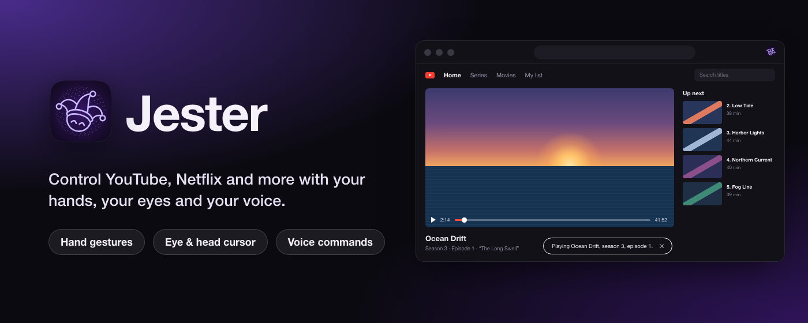

# Jester

Work your computer with your voice, your hands and your eyes.



Jester comes in two parts that work alone or together:

| | What it is | Get it |
|---|---|---|
| **Jester Desktop** | A voice assistant that lives in your menu bar. Say his name and talk to him: he answers aloud, works any app for you, keeps your reminders and timers, and can tell you about your day. Hand gestures and an eye or head pointer are there when you want them. | [Mac (Apple silicon)](https://github.com/KrishSChavan/jester/releases/latest/download/Jester-mac-arm64.dmg) · [Windows (preview)](https://github.com/KrishSChavan/jester/releases/latest/download/Jester-windows-x64-setup.exe) |
| **Jester for Chrome** | An extension that controls video and web pages with gestures, an eye or head cursor, and spoken commands such as “play season 3 episode 1 of Rick and Morty”. | [Chrome Web Store](https://chromewebstore.google.com/detail/jbfmeaijggbkkakdiinamgjjmcfblpab) |

Speech is recognized on your own computer, and so is everything the camera
sees. What you say reaches a model only as text, and only the model you chose.

## Start here

**I want the desktop app**

1. Download it: [Mac](https://github.com/KrishSChavan/jester/releases/latest/download/Jester-mac-arm64.dmg) or [Windows](https://github.com/KrishSChavan/jester/releases/latest/download/Jester-windows-x64-setup.exe).
2. Install and open it. The first time, your computer will warn that it can't
   verify the app; the install guide shows the two clicks that get past that:
   [Mac](docs/install-mac.md) · [Windows](docs/install-windows.md).
3. Follow **Getting started** in his window. It takes about five minutes:
   [what each step is](docs/first-run.md).

**I want the Chrome extension**

1. Add it from the [Chrome Web Store](https://chromewebstore.google.com/detail/jbfmeaijggbkkakdiinamgjjmcfblpab).
2. Open its Settings, allow the camera and microphone, and add a model.
   [The extension guide](docs/chrome-extension.md) has the details.

**I want both, working together**

Install both, then in the extension's Settings press **Link with Jester
Desktop**. They share one camera and microphone, and he can work your tabs
and pages. (Mac only for now.)

## What you need

- **Mac:** Apple silicon (M1 or later), macOS 13 or later.
- **Windows:** Windows 10 or 11, 64-bit. The Windows build is a preview: see
  [what that means](docs/install-windows.md#what-preview-means).
- **Something for him to think with**, either of:
  - an API key for Claude, Gemini, Groq, OpenAI or a compatible service
    (Groq and Gemini have free plans), or
  - [Ollama](https://ollama.com) running a model on your own computer, which
    costs nothing and sends nothing anywhere.
- About 1 GB of free disk space. The first time he opens he downloads what he
  hears and speaks with (about 500 MB), by himself.

## What he asks permission for

Nothing up front. Jester asks for each permission at the moment something
first needs it, and if you ask him for something he isn't allowed to do, he
says so and tells you where to allow it.

| Permission | Asked for when | What it's for |
|---|---|---|
| Microphone | You turn on listening, or start a voice command | Hearing you. Audio never leaves your computer. |
| Accessibility (Mac) | He first has to click, type or read a window | Working apps for you. |
| Camera | You turn on Gestures or the eye/head pointer | Seeing your hand and face. Frames never leave your computer. |
| Location | You set Location to this computer | The weather, and what's near you. |
| Screen Recording (Mac) | A model that reads pictures first needs one | A picture of the window he's working in. Optional. |
| Bluetooth (Mac) | You turn on the Apple Watch | Steering the pointer with your watch. |

More in [Permissions](docs/permissions.md).

## Documentation

| | |
|---|---|
| [Install on a Mac](docs/install-mac.md) | Download, the "can't verify" warning, moving him to Applications, updating |
| [Install on Windows](docs/install-windows.md) | Download, SmartScreen, what the preview does and doesn't do yet |
| [Getting started](docs/first-run.md) | The first five minutes: a model, listening, and what you can add |
| [Permissions](docs/permissions.md) | Each permission, when it's asked for, and where to change it |
| [The Chrome extension](docs/chrome-extension.md) | Installing it, linking it to the desktop app |
| [His tools, and the choices he keeps](docs/tools.md) | Where he does each thing, when he asks you, what he remembers, and lending his tools to other apps |
| [Troubleshooting](docs/troubleshooting.md) | What to try when he doesn't hear, answer, click or link, and where his log is |
| [What leaves your computer](docs/privacy-desktop.md) | For the desktop app. The extension's policy is [PRIVACY.md](PRIVACY.md) |
| [Building from source](docs/building.md) | Running from a checkout, the tests, packaging, making a release |
| [Roadmap](docs/roadmap.md) | What's done and what's next |

Going deeper:

- [How the desktop app works](desktop/README.md): its design, file by file,
  and what was learned building it. Long.
- [How the extension works](jester-extension/README.md): gestures, the agent,
  token limits.
- [Jester on a server](desktop/server/README.md): his brain on a small cloud
  machine, reachable from your phone, with your Mac as his hands.

## What's in this repository

| Folder | What it holds |
|---|---|
| [`desktop/`](desktop/) | Jester Desktop: the Electron app (`src/`), its native helpers (`native/`: Rust, Swift, Objective-C), its scripts and packaging |
| [`jester-extension/`](jester-extension/) | Jester for Chrome. The desktop app runs the same gesture engine from this folder |
| [`tests/`](tests/) | Tests for both (`npm test`): about 1,600, none needing a camera, a microphone or a paid model |
| [`docs/`](docs/) | The guides listed above |
| [`store/`](store/) | The Chrome Web Store listing: text, screenshots, promo tiles |
| [`.github/workflows/`](.github/workflows/) | Builds the Mac and Windows downloads and publishes a release when a version is tagged |

## Building from source

```sh
git clone https://github.com/KrishSChavan/jester.git
cd jester/desktop
npm install
npm run driver      # the helper that clicks and types; needs Rust
npm start           # he fetches his speech models himself on first run
```

Tests run from the repository root with `npm test`. Everything else, including
how the downloads are built, is in [Building from source](docs/building.md).

## License

[MIT](LICENSE). The speech models Jester downloads, and the libraries he's
built on, have their own licenses: see [Building from source](docs/building.md#what-jester-is-built-on).
